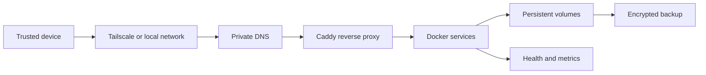

# Homelab Guide

A reusable blueprint for a private, Docker based homelab. It explains the roles of a reverse proxy, private DNS, remote access, monitoring, backups, and self hosted services. The names, addresses, and paths in this repository are examples; they are not an inventory of a running server.

## Design at a glance



The guide covers Docker Compose, Caddy, Tailscale, AdGuard Home, Homepage, Uptime Kuma, Prometheus, and Grafana. The runnable Compose example starts only Caddy, Homepage, and Uptime Kuma. The [service catalogue](docs/services.md) explains optional media, photo, file, and management services. Each component is independent: start with a proxy and one app, then add what you need.

## Start here

1. Read the [architecture](docs/architecture.md), [networking](docs/networking.md), and [security](docs/security.md) guides before exposing a port.
2. Create a working directory **outside this repository**. Copy [the environment example](examples/environment/.env.example) there as `.env`. Replace the sample hostnames and choose a bind address for your network. Never commit `.env`.
3. Copy [the Compose example](examples/docker/compose.example.yml) there as `compose.yml` and copy [the Caddyfile](examples/caddy/Caddyfile) there as `Caddyfile`. Create a `homepage` directory beside them. The examples are a learning starting point; pin images, configure each app, and review permissions before long term use.
4. Configure private DNS for the names you chose. Caddy's internal CA must be trusted on clients that access those names; see [reverse proxy](docs/reverse-proxy.md).
5. Add monitoring and a tested backup before relying on a service. See [monitoring](docs/monitoring.md) and [backups](docs/backups.md).

From the repository root, the copies in steps 2 and 3 can be made with:

```bash
mkdir -p ../homelab-example/homepage
cp examples/environment/.env.example ../homelab-example/.env
cp examples/docker/compose.example.yml ../homelab-example/compose.yml
cp examples/caddy/Caddyfile ../homelab-example/Caddyfile
```

Edit `../homelab-example/.env`, then validate from that working directory with `docker compose config` before starting containers.

## Guides

| Topic | Purpose |
| --- | --- |
| [Architecture](docs/architecture.md) | Components and trust boundaries |
| [Networking](docs/networking.md) | Private DNS and traffic flow |
| [Security](docs/security.md) | Access, secrets, updates, and review |
| [Reverse proxy](docs/reverse-proxy.md) | Caddy and local HTTPS |
| [Remote access](docs/remote-access.md) | Tailnet access without public exposure |
| [Monitoring](docs/monitoring.md) | Uptime and metrics |
| [Backups](docs/backups.md) | Restore focused backup plan |
| [Services](docs/services.md) | Optional applications and their data |

## Repository safety

This guide deliberately contains no live configuration, credentials, private domains, server identity, Tailscale address, or actual storage path. Keep real `.env` files, app data, certificates, database dumps, and backups outside Git. Before publishing a change, review the staged diff and run a secret scanner against the repository history. A private GitHub repository is still a shared copy of anything pushed to it.

There is no automated deployment from this repository. Adapt and verify examples on your own host.
